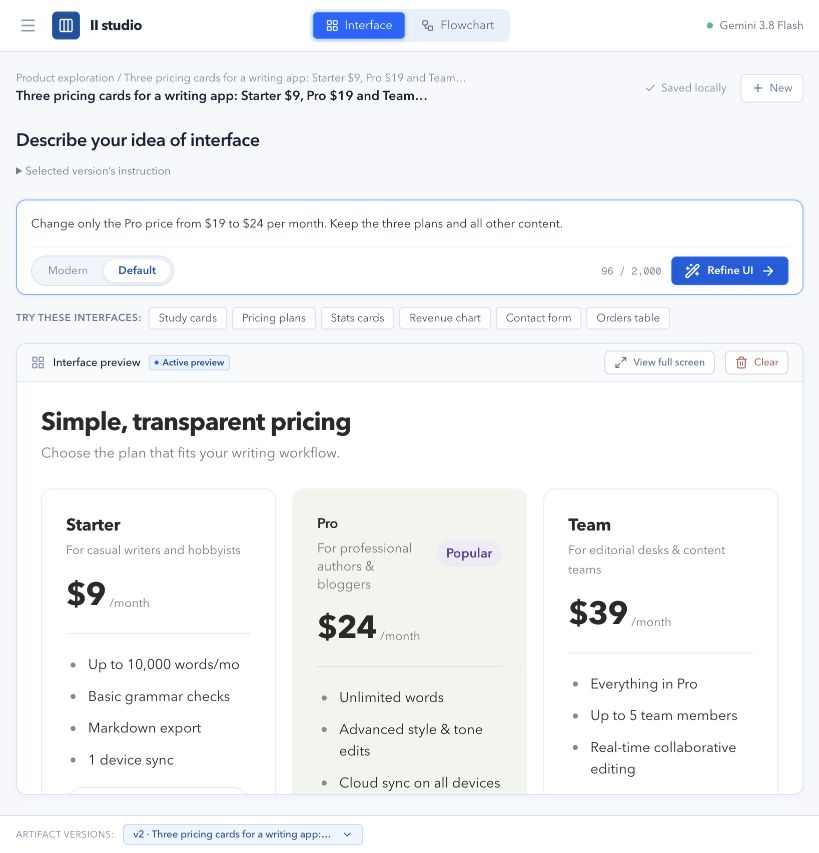
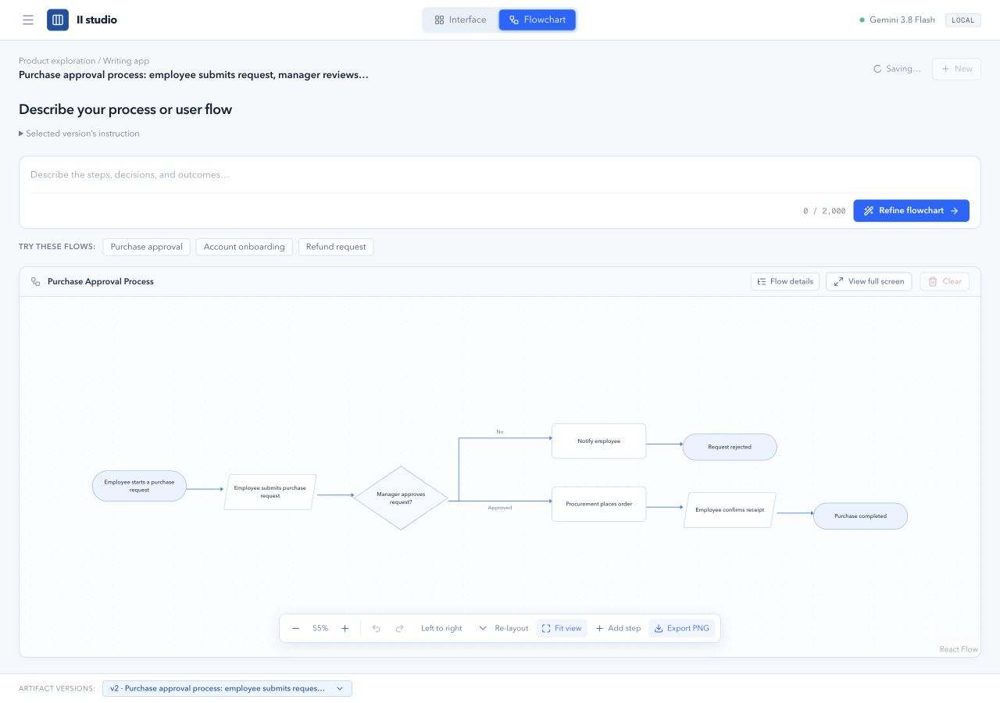

# II studio

**From requirements to interactive interfaces and editable workflows.**

Created by **[Mahesh V V](https://www.linkedin.com/in/vvmahesh/)** · [@vvmahesh0](https://github.com/vvmahesh0)

II studio helps designers, product managers, founders and business analysts explore an idea using their own AI connection. Describe a dashboard, form, widget or process; watch it render, refine it and keep its history locally.

**v0.1.0 release candidate · Apple Silicon macOS · Local-first · Apache-2.0**

Website: [iistudio.vercel.app](https://iistudio.vercel.app/)

## What you can create

- **Interface Studio:** Default and Modern component libraries, shadcn-based layouts/blocks, forms, tables, charts, local interactions, whole-interface and targeted refinements.
- **Flowchart Studio:** structured business/user flows, editable steps and arrows, automatic layout, undo/redo and AI refinement.
- **Workspace:** local projects, conversations, artifacts and numbered versions. New and Clear preserve saved work.
- **Handoff:** fullscreen, Copy PNG, Export PNG, experimental editable Figma transfer. Workspace backup controls are currently hidden.

Generated interfaces use registered components. They do not deploy applications, fetch live business data, implement authentication or run arbitrary model-written code. Unconnected actions have no backend.

## Quick start

Requirements: **Apple Silicon Mac (arm64), Node.js 24+, npm, and a supported CLI installed and signed in**. The app does not install AI CLIs or include a model subscription. Other platforms are unverified.

Clone [vvmahesh0/ii-studio](https://github.com/vvmahesh0/ii-studio), then open its folder:

```sh
git clone https://github.com/vvmahesh0/ii-studio.git
cd ii-studio
```

Then:

```sh
npm run setup
```

The setup checks prerequisites, preserves existing configuration, runs npm ci and creates .env.local from .env.example if absent. Edit the ignored .env.local to select a provider. Then:

```sh
npm run dev
```

Open **http://127.0.0.1:3000** (use the URL printed by Next if that port is occupied). There is no account, shared-key demo, quota database or hosted service to configure.

Manual alternative:

```sh
npm ci
cp -n .env.example .env.local
npm run dev
```

For a production build:

```sh
npm run build
npm start
```

Reopen later by returning to this folder and running npm start (after building) or npm run dev. Keep the same browser/profile and URL to access saved projects. Stop the server with Control-C.

## AI connection

Set `II_CLI_PROVIDER=antigravity`, `codex`, `claude` or `gemini`. `II_MODEL` optionally selects a model supported by that CLI. Configure absolute `II_CODEX_PATH` etc. only if automatic PATH detection fails. See [.env.example](.env.example) and [provider compatibility](docs/PROVIDERS.md).

Use the **Connection** control to choose an installed provider and optional model for the current server session. Installation detection is not authentication verification. Authenticate in the provider's own terminal workflow; never paste credentials into prompts or project backups. The app does not bundle, redistribute or guarantee entitlement to third-party models. Usage limits and provider charges still apply.

**Provider support has different verification levels. Read the compatibility table before choosing.** No automatic provider fallback or permission bypass is performed. Progressive rendering is retained; latency and chunk size depend on the CLI/model. No fixed speed is promised.

## Try it

- “Create three pricing plans for a project management app.”
- “Create a dashboard with four metrics, a revenue chart and a searchable customer table.”
- “Create a contact form with name, email, project type and message.”
- “Create a purchase approval process. Purchases above ₹50,000 need finance approval; rejected requests end; incomplete requests return for revision.”

Refine an existing result, or Clear to create another artifact. Choose Interface or Flowchart in the header. Completed valid results autosave; Stop and failed generations preserve the last valid version.

## Data, privacy and limitations

Projects are saved in **this browser's IndexedDB**, not in a studio account or cloud. Different browser profiles/ports/origins have separate workspaces. Browser cleanup/private browsing can erase data. Avoid clearing browser storage: backup controls are currently hidden. There is no cloud synchronization.

Your prompt and relevant design context go to your selected inference provider through its CLI. Cloud inference needs internet. II studio has no telemetry or application usage reporting. Read [SECURITY.md](SECURITY.md).

Avenir Next is used when installed on macOS, with local fallbacks. Proprietary fonts are not bundled. PNG capture has browser/canvas and oversized-content limitations; see [capture rules](docs/COPY-EXPORT.md). Generated local interactions do not imply production integrations.

## Figma Adapter — experimental

Use **Copy for Figma** on a completed supported interface. Install the bundled development plugin from public/downloads/ii-studio-figma-plugin.zip; see [plugin installation](tools/figma-adapter-poc/plugin/INSTALL.md). Paste with Command-V into its paste target to import supported editable layers.

Transfer is partial and not live synchronization. Charts/icons may become vectors; unsupported content is rejected with guidance. Web behavior does not transfer. Current user-reported failures remain under investigation; PNG is the reliable visual alternative. No Figma bridge/MCP is required by end users.

## Development and setup help

```sh
npm test
npm run lint
npm run build
npx tsc --noEmit
```

Tests use synthetic fixtures and do not require paid inference. Build regenerates catalogs, the Figma plugin and the ELK worker assets. See [architecture](docs/ARCHITECTURE.md), [troubleshooting](docs/TROUBLESHOOTING.md), [AI-agent setup prompt](docs/AGENT-SETUP.md) and [release checklist](docs/RELEASE-READINESS.md).

### Actual product examples

These are authentic screenshots from earlier local verification, not newly captured images of this release candidate. Some controls and limits shown have since changed.





## Contributing and attribution

Issues are welcome and pull requests are reviewed selectively. See [CONTRIBUTING.md](CONTRIBUTING.md). There is no support SLA. Original II studio work is licensed under [Apache-2.0](LICENSE); upstream components retain their own licenses and notices in [THIRD_PARTY_NOTICES.md](THIRD_PARTY_NOTICES.md).

Created by **[Mahesh V V](https://www.linkedin.com/in/vvmahesh/)** · [GitHub](https://github.com/vvmahesh0). Repository publication, releases and website changes require the creator's separate approval.
